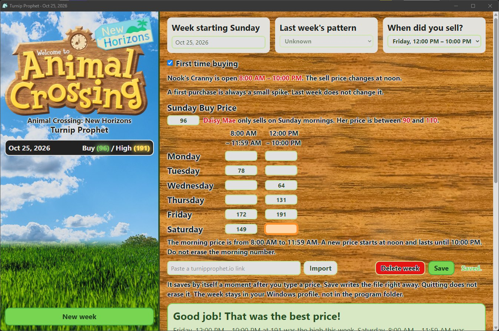
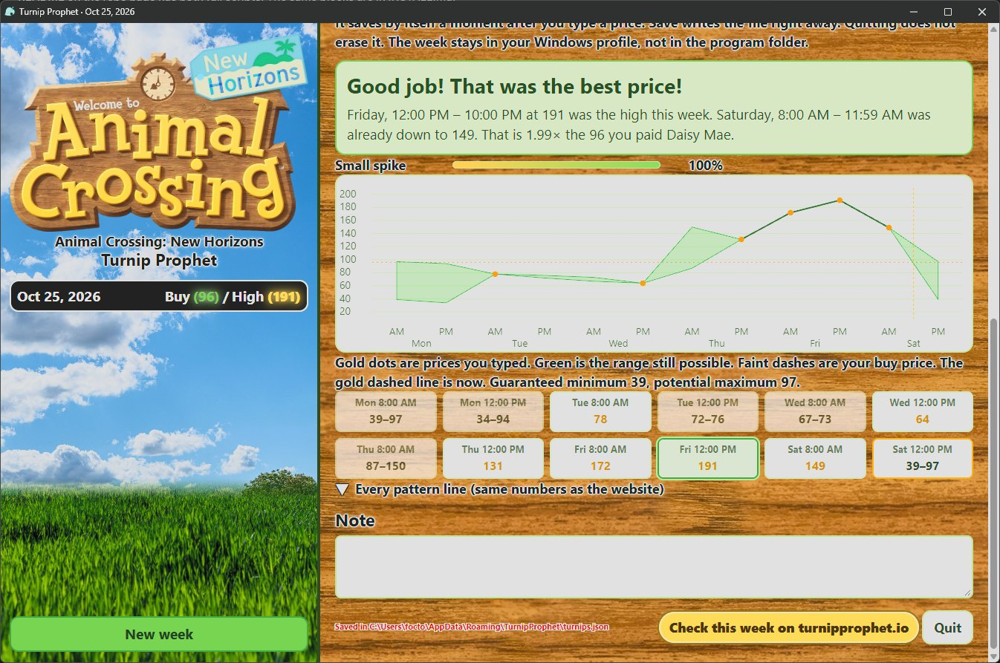
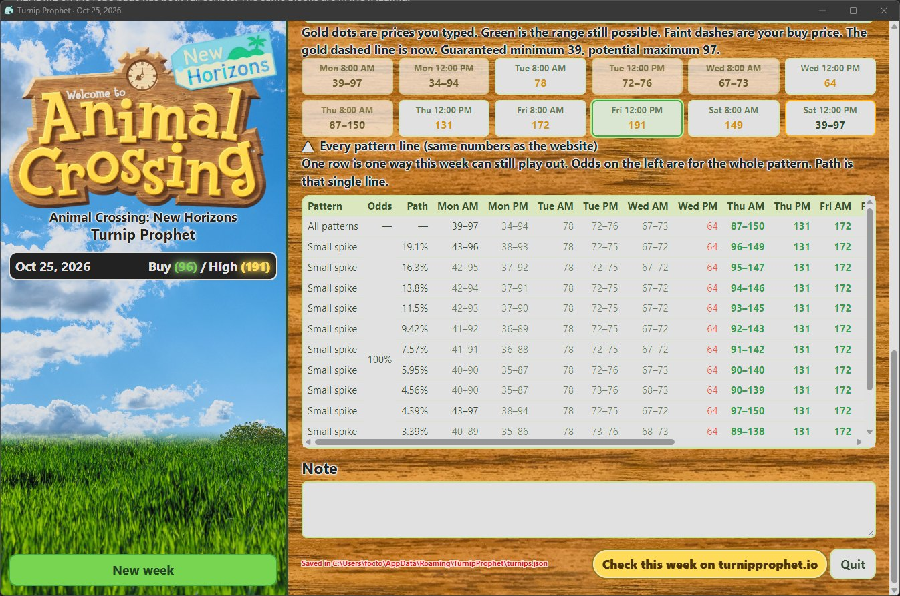

# Animal Crossing: New Horizons - Turnip Prophet

A small Windows tracker for Daisy Mae's turnip prices. Type each price as the week goes, it saves on this PC, and it tells you whether to sell or wait.

The price math is the same engine as [turnipprophet.io](https://turnipprophet.io) (Mike Bryant's [ac-nh-turnip-prices](https://github.com/mikebryant/ac-nh-turnip-prices), from Ninji's reverse engineering of the game). This repo adds a window, a desktop shortcut, and a saved history. It is not the website, and it is not made by Nintendo.

## What it looks like

The left side is the week list. The right side is where you type the prices.







## Install

Pick one. Do not run both at once. Weeks go to `%AppData%\TurnipProphet\turnips.json` either way. Quit Turnip Prophet first if it is already open. More detail is in [INSTALL.md](INSTALL.md).

**Windows installer.** Program Files, Start menu, uninstall from Settings. Paste this whole block into PowerShell:

```powershell
$d = Join-Path $env:TEMP 'TurnipProphet'
if (Test-Path $d) { Remove-Item $d -Recurse -Force }
New-Item -ItemType Directory -Path $d | Out-Null
Invoke-WebRequest 'https://github.com/foctober/Animal-Crossing-New-Horizons-Turnip-Prophet/archive/refs/heads/main.zip' -OutFile "$d\src.zip"
Expand-Archive "$d\src.zip" $d -Force
Start-Process -FilePath "$d\Animal-Crossing-New-Horizons-Turnip-Prophet-main\TurnipProphet-Setup.exe" -Verb RunAs -Wait
Remove-Item $d -Recurse -Force
```

Windows asks for permission. SmartScreen may say the installer is unrecognized. More info, then Run anyway, if you trust this repo. The app goes in `C:\Program Files\Turnip Prophet`.

**PowerShell.** No installer. The app goes in `C:\Tools\Turnips`. Paste this whole block into PowerShell:

```powershell
$d = Join-Path $env:TEMP 'TurnipProphet'
if (Test-Path $d) { Remove-Item $d -Recurse -Force }
New-Item -ItemType Directory -Path $d | Out-Null
Invoke-WebRequest 'https://github.com/foctober/Animal-Crossing-New-Horizons-Turnip-Prophet/archive/refs/heads/main.zip' -OutFile "$d\src.zip"
Expand-Archive "$d\src.zip" $d -Force
powershell -ExecutionPolicy Bypass -File "$d\Animal-Crossing-New-Horizons-Turnip-Prophet-main\Install.ps1"
Remove-Item $d -Recurse -Force
```

The shortcut, the tray icon, and the window icon are the teal leaf.

## What you see

The left side is the week list, on a field that fades into sky. The grass is the bottom quarter. The right side is where you type the prices, on wood. Across the top of the list is the Animal Crossing: New Horizons logo, then the title on two lines: **Animal Crossing: New Horizons** and **Turnip Prophet**.

The top three fields are three equal cards. Inside each card the label is left-aligned with its box. The date and both dropdowns are bold. Last week's pattern stays grey while First time buying is checked. Uncheck that and the pattern box is bold like the other two. The price box for the shop window that is open right now is pumpkin orange. Sunday morning is the buy box. Monday through Saturday, morning is 8:00 AM – 11:59 AM and afternoon is 12:00 PM – 10:00 PM. Outside those hours nothing is marked.

Under the prices is the prediction: the banner, the odds, the chart, the twelve sell slots, and the full pattern table if you open it.

## What you do each week

1. Sunday morning, type what Daisy Mae charges. It is always 90–110.
2. When you check Nook's Cranny, type that price in the morning or afternoon box. Morning is 8:00 AM – 11:59 AM. Afternoon is 12:00 PM – 10:00 PM. Do not wipe the morning number.
3. Read the banner. It says sell or wait, in plain words.
4. Next Sunday, click **New week**. If this week was a sure pattern, the new week starts with that filled in as "last week's pattern."

Weeks are stored in `%AppData%\TurnipProphet\turnips.json` (usually `C:\Users\<you>\AppData\Roaming\TurnipProphet\turnips.json`). Neither install keeps the weeks in the program folder. Quit from the button in the window, or right-click the tray icon. Closing the window alone leaves the app running so the next double-click just reopens it.

## Saving

It saves by itself, about a second after you change a price, the note, or the sell time. The **Save** button writes `%AppData%\TurnipProphet\turnips.json` immediately. Quit does not wipe that file. Close the window, open the shortcut again, and the week is still there. The first time this version runs, it copies an old `C:\Tools\Turnips\turnips.json` into AppData and renames the old file `turnips.json.migrated`.

## When you sold

Pick **When did you sell?** Every day has the same two windows: 8:00 AM – 11:59 AM, then 12:00 PM – 10:00 PM. That is when Nook's Cranny is open, and the price changes at noon. The banner then says:

- **Good job** if that was the best price of the week, or within 10 bells of it, and nothing later can beat it.
- **Too soon** if a later price was higher.
- **Too late** if an earlier price was the high, or the turnips spoiled.

## How to read the result

The banner is the part that matters.

- **Sell now** means every price still left this week is worse than a price you already saw. Sell whatever you are still holding.
- **Wait** means a later slot can still beat the price Nook is offering right now.
- The green band on the chart is the range the math still allows. Gold dots are numbers you typed. The faint dashed line is your buy price. The gold dashed vertical line is "now" — everything to the right has not happened yet.
- **Guaranteed minimum** and **Potential maximum** use the same meaning as the website, so you can compare the two. The minimum is the best floor still hiding in the remaining pattern. The maximum is the highest price the math still allows.
- **Every pattern line** (the collapsed table) is the full website output: one row per way the week can still happen.

Blank days you already passed stay as ranges. You cannot go back and sell those. Only slots after your last typed price are still ahead.

## Notes on the patterns

The game picks one pattern per week, per island. Your buy price is the base. Sell prices are half-days, Monday morning through Saturday afternoon.

| Pattern | What it feels like | About how high |
| --- | --- | --- |
| Fluctuating | Up and down all week, no real spike | about 1.4× the buy price |
| Large spike | Drifts down, then one huge peak, then junk prices | up to about 6× |
| Decreasing | Down all week and it does not come back | stays under the buy price |
| Small spike | Drifts down, a modest peak, then down again | about 2× |

A first-time buyer always gets a small spike. The "First time buying" box forces that, same as the website.

What happened last week changes the odds for this week:

| Last week | Fluctuating | Large spike | Decreasing | Small spike |
| --- | --- | --- | --- | --- |
| Fluctuating | 20% | 30% | 15% | 35% |
| Large spike | 50% | 5% | 20% | 25% |
| Decreasing | 25% | 45% | 5% | 25% |
| Small spike | 45% | 25% | 15% | 15% |
| Unknown | about 35% | about 25% | about 15% | about 26% |

If you do not know last week, leave the dropdown on Unknown. The unknown row is the steady-state mix the website uses.

Turnips spoil when Sunday starts. Saturday afternoon is the last chance to sell.

## Worked example (week of Oct 18, 2026)

This is the week filled in the first time you open the app. Buy 96, first time buying, and these sell prices:

| | Mon | Tue | Wed | Thu | Fri | Sat |
| --- | --- | --- | --- | --- | --- | --- |
| AM | | 77 | | | 172 | 149 |
| PM | | | 64 | 132 | 191 | |

That link is:

`https://turnipprophet.io/?prices=96...77...64..132.172.191.149.&first=true`

With "First time buying" on, the engine says **small spike, 100%**. Friday, 12:00 PM – 10:00 PM at 191 was the peak (just under 2× 96). Saturday, 8:00 AM – 11:59 AM is already down at 149. Saturday, 12:00 PM – 10:00 PM only comes out between **39 and 97**.

Sell during Saturday morning if you still have any. Waiting for the afternoon loses bells. The website's guaranteed minimum for what is left is 39, and the potential maximum is 97. The seed week records that sale as Friday afternoon, so the banner says it was a good job.

You can paste that link into the import box on any week and the app fills the grid.

## Run it

Open **Turnip Prophet** from the desktop or the Start menu. A second launch does not start a second copy. It reopens the window. The PowerShell copy can also be started with `C:\Tools\Turnips\Run.cmd`.

## Files

| File | What it is |
| --- | --- |
| `TurnipProphet-Setup.exe` | Windows installer. Puts `TurnipProphet.exe` in Program Files. |
| `Install.ps1` | PowerShell install. Copies the script app to `C:\Tools\Turnips`. |
| `Turnips.ps1` | The PowerShell app. Local page plus the tray icon. |
| `Launch.vbs` / `Run.cmd` | Start the PowerShell app with no PowerShell window. |
| `TurnipProphet.ico` | The leaf icon for the shortcut, the tray, and the installer. |
| `www\` | The window you actually look at. `logo.png` is the wide title art. `field.jpg` is the left side. `wood.png` is the right side. |
| `predictions.js` | Unmodified Turnip Prophet engine. |
| `turnips.json` | Your weeks. Lives in `%AppData%\TurnipProphet\`, not next to the program and not in git. |

## Updating

Quit the app first (tray icon or the Quit button).

- Installer: run `TurnipProphet-Setup.exe` again over the same folder.
- PowerShell: `git pull`, then `powershell -ExecutionPolicy Bypass -File .\Install.ps1`.

Neither one touches the weeks file in AppData.

## Uninstall

Quit first. The weeks stay in `%AppData%\TurnipProphet\turnips.json`. Delete that folder only if you want the history gone.

- Installer: Windows Settings, Apps, Turnip Prophet, Uninstall.
- PowerShell: delete the desktop shortcut and delete `C:\Tools\Turnips`.

## License

Apache License 2.0. See [LICENSE](LICENSE) and [NOTICE](NOTICE).

The prediction engine is Mike Bryant's, thanks to Ninji. This project is not affiliated with Nintendo.
